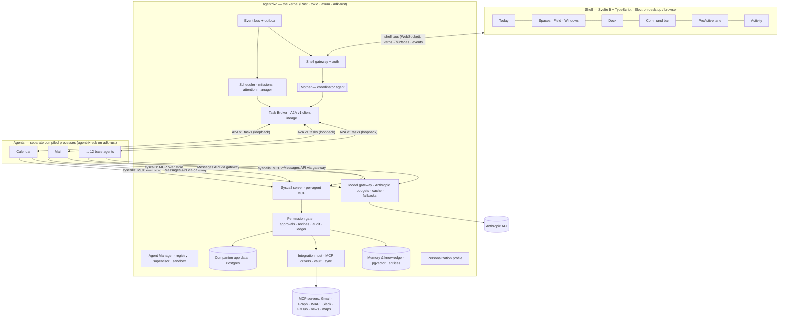

# Agentrix OS 1.0 — The Agentic Operating System

**Status:** Proposed (2026-10-17) · **Supersedes:** the scenario architecture of Phase 1 and the
prototype shell; **builds on** the Phase 2 trust primitives (`PERSONAL_AI_OS.md`, ADR-001…006).
**Companion documents:** [`BASE_AGENTS.md`](BASE_AGENTS.md) (the agent and app inventory),
[`ROADMAP_1_0.md`](ROADMAP_1_0.md) (delivery plan), ADR-007…014 (decisions).

> **Agents are the new apps.** Every capability of the OS is a specialised, compiled agent with its
> own tools, skills, memory scope and companion app. One coordinator — the Mother — turns what the
> person says, types, touches or gestures into work for those agents, keeps them honest, and
> speaks with one voice.

---

## 0. Why a rethink

The prototype proved the *experience* (a spatial field of cards, worlds, a coordinator voice) and
Phase 2 proved the *trust primitives* (permission gate, effect classes, content-free ledger,
user-owned memory). The October 2026 reviews showed what stands between that and an OS someone
can live in:

| What we learned | Evidence | What 1.0 does instead |
|---|---|---|
| Scenarios are not agents. Seven scripted workflows stood in for sixteen "agents". | `src/orchestrator/*`, `events/mock.rs`; "Start my day" picked a random scenario | Agents are installable, compiled programs with declared capabilities (§3) |
| Without real data the UI fabricates. Mock cards, fake "✓ Done", client-side fuse text. | UX review 2026-10-17 | **Local-first companion apps** own real data from minute one; no mock path in the live OS (§5) |
| Trust features existed only as APIs. Modes, pause, memory, consents had no UI; approvals could never fill. | Functional audit; every allowlisted effect was `read`/`write_local` | Trust Center, real effectful tools, approvals as surfaces (§8, §10) |
| Integrations were hard prerequisites. No MCP binary → stub; no OAuth from the UI. | MCP inventory: 0 release binaries, calendar exits without a token | Integrations are optional sync drivers into local apps, connected in onboarding (§5.3, §9) |
| The coordinator was keyword routing + templates. | `mother/intake.rs` rules; LLM Mother built but never called | A real coordinator: fast deterministic routing + an LLM planner + synthesis (§4) |
| One process did everything; a crash or a bad tool took the OS down. | `src/main.rs` 900 lines of boot | A kernel that supervises agent processes and mediates every model call, tool call and secret (§2) |

## 1. Product definition — what "ready for practical use" means

Agentrix OS 1.0 is a desktop operating environment (macOS first; Windows and Linux follow; the same
shell runs in a browser) that a person installs, onboards in five minutes, and then uses daily for
mail, calendar, tasks, notes, files, people, research and their own patterns — mostly by asking.

**It must:**

1. Work on day one **with no integrations**: the companion apps are real local apps (§5).
2. Get better with every connection (Google, Microsoft, IMAP, Slack, GitHub, bank read-only,
   health export) without ever pretending a connection exists.
3. Let the person see and control everything an agent can do: modes per agent and tool, one-switch
   pause, approvals, audit, memory, consents, budgets.
4. Feel instant: local actions under 50 ms, first agent output under 1.5 s (§11.3).
5. Accept text, mouse, touch, keyboard, voice and camera through **one verb grammar** (§10.3).
6. Run agents autonomously in the background — missions with goals, budgets and schedules — and
   surface what matters, politely (§4.6, §10.5).

**1.0 acceptance journeys** (automated with Playwright using text, mouse and touch; voice and
camera are built to the same verb contract and verified when Google keys are available):

| # | Journey | Proves |
|---|---|---|
| J1 | Onboard in < 5 min; the custom instruction "calm, warm, brief; brief me at 7:30; no meetings before 10" changes the theme, the briefing time and scheduling behaviour | Onboarding, personalization, rules |
| J2 | "Plan my day" → Calendar + Tasks + Mail contribute → one plan surface → accept → events and tasks exist in the apps | Mother planning, multi-agent, real writes |
| J3 | "30 minutes with Priya next week about the launch" → People resolves Priya → Calendar finds a slot respecting rules → invite surface → approve → event + invitation sent (Google connected) or `.ics` drafted (local) | Cross-agent chain, `schedule_with_others` approval |
| J4 | Drag an email onto the Tasks dock icon → task with a back-link | VerbUI delegate by drag (mouse and touch) |
| J5 | Drop a research brief onto a deck card → Files & Docs combines them into a real `.pptx` | Fuse is real work |
| J6 | "Remember I prefer morning meetings" → later scheduling cites "(you told me)" | Memory kinds, provenance |
| J7 | An overnight Research mission finds news on a watched topic → ProActive lane card with "why", snooze, "less like this" | Missions, attention manager |
| J8 | "Keep my inbox triaged every morning" → mission survives a kernel restart and an agent crash | Durability, supervision |
| J9 | Mail set to Observe explains why it can't draft; Suggest → drafts await approval; Pause all → nothing runs; Resume | Trust Center, gate |
| J10 | Memory app: see, confirm, correct, export (JSON), delete | Memory ownership |
| J11 | "Find where I described the pricing model" → hybrid search over notes, files and mail → preview | Semantic memory |
| J12 | Install the Developer agent from the Store, connect GitHub, choose a mode → it appears in the Dock | Agents as apps |
| J13 | No Anthropic key / offline → apps fully usable by hand; Mother states it is offline; nothing fabricated | Honest degradation |

## 2. System architecture



### 2.1 The kernel (`agentrixd`)

One Rust process per person (ADR-005), owning everything that must be trusted:

| Component | Responsibility | Built on |
|---|---|---|
| **Shell gateway** | Serves the shell, authenticates the owner and paired devices, multiplexes one WebSocket "shell bus" (events, surfaces, verb intents, presence, streaming) | axum 0.8, existing `auth.rs` (hardened in #25) |
| **Mother** | The coordinator agent (§4). Runs *in* the kernel for latency and privileged registry access, behind the same `Agent` trait as everyone else | adk-agent `LlmAgent`, adk-skill |
| **Agent Manager** | Registry of installed agents (Postgres), install / enable / update, process supervision (spawn, health, restart with back-off, idle stop, warm pool), sandbox profiles | new; adk-sandbox (Seatbelt / bubblewrap) |
| **Task Broker** | Sends A2A v1 tasks to agents, keeps a durable task store with parent/child lineage, relays streaming updates, cancels for real, resumes `input-required` tasks | adk-server A2A v1 + upstream fixes (§13.3) |
| **Syscall server** | One MCP server session per agent process over the agent's stdio: the *only* way an agent touches data, tools, memory, UI or peers | rmcp 3 (server side) |
| **Permission gate** | Effect classes, modes, approvals, pause, recipes, audit, ledger — the single authority for every effect, including MCP 2026 `input_required` prompts from integration servers | existing `src/permissions/*` + adk-core `ToolPolicy` / `ApprovalService` / `GovernanceControl` / `SpendLedger` |
| **Model gateway** | Anthropic Messages endpoint for agents: holds the API key, applies policy (effort, caching, fallbacks, betas), enforces budgets, records usage | adk-anthropic; `SpendLedger` |
| **Companion app data** | Postgres schemas for Calendar, Mail, Tasks, Notes, Files, People, Reader, Finance, Health; change feed into the bus | sqlx 0.9 |
| **Memory & knowledge** | Facts, episodes, documents, entity graph; local embeddings; hybrid retrieval; consolidation (§6) | pgvector; adk-memory / adk-rag where they fit |
| **Scheduler & missions** | Cron, event and condition triggers; long-running missions with checkpoints; attention manager for ProActive | adk `DurableScheduler` + `DurableWorker` on Postgres |
| **Integration host** | Spawns MCP integration servers, stores OAuth tokens in the vault, runs sync drivers that mirror external data into the apps | existing `tools/mcp.rs`; `mcp-credentials-vault` or kernel vault |
| **Personalization** | The OS profile compiled from onboarding and custom instructions (§9.2) | new |
| **AWP endpoint** | External agents reach the Mother through the Agentic Web Protocol | existing `awp_gate.rs` |

### 2.2 Agents (processes)

Each agent is its own binary built with **`agentrix-sdk`** (§3.4) on adk-rust. A running agent:

- **receives work** as A2A v1 tasks on a loopback port with a per-launch bearer token;
- **calls the kernel** for everything else through MCP syscalls on its stdio;
- **thinks** through the kernel's model gateway with a per-agent token — it never holds an API key;
- **has no database, no secrets and no network** except loopback to the kernel (sandboxed, ADR-008).

### 2.3 Integrations

MCP servers (the `mcp-servers` monorepo) become **drivers**, not agents: the integration host
runs them, and sync drivers mirror their data into companion apps (Gmail → Mail, Google Calendar
→ Calendar, Slack → Team). Agents use integration tools only through syscalls, so the gate,
audit and ledger see every call. Servers built from `mcp-servers` `origin/main` gate their own
write tools with MCP 2026 `input_required`; the kernel answers those prompts only after its gate
has approved the action — **one approval, not two** (ADR-008).

### 2.4 The five flows

1. **Intent.** Shell → gateway → Mother intake → plan → Task Broker sends A2A tasks (in parallel
   where independent) → agents run model loops through the gateway and syscalls → surfaces and
   progress stream to the shell → Mother synthesizes one answer.
2. **Direct manipulation.** The person edits an event in Calendar → app API → data layer → change
   event on the bus → subscribed agents may react (e.g. Calendar detects a new conflict).
3. **Action on a surface.** "Send" on a draft → verb routed to the owning task → syscall → gate
   (a click on an explicit Confirm surface *is* the approval) → integration → result surface.
4. **Proactive.** Trigger (cron, app event, condition) → scheduler → background task → agent
   proposes a ProActive item → attention manager picks interrupt, lane, digest or drop.
5. **Mission.** The person states a standing goal → Mother creates a mission (goal, agents,
   cadence, budget, autonomy) → durable worker runs steps, checkpoints, parks on approvals →
   reports through ProActive and the Activity monitor.

## 3. The agent model — agents are apps

### 3.1 Package layout

```
agents/calendar/
  agent.toml            # manifest: identity, capabilities, tools, effects, memory, triggers, UI
  Cargo.toml            # binary crate: agentrix-agent-calendar
  src/main.rs           # agent logic on agentrix-sdk (deterministic code + LLM loop)
  prompts/system.md     # stable, cache-friendly system prompt
  skills/<name>/SKILL.md  # progressive skills (agentskills.io format; adk-skill)
  surfaces/*.json       # surface templates the agent renders into (A2UI-style, §10.4)
  evals/*.yaml          # trajectory + outcome evals (adk-eval)
  icon.svg
```

### 3.2 Manifest (`agent.toml`)

```toml
[agent]
id        = "calendar"
name      = "Calendar"
version   = "1.0.0"
summary   = "Plans your time: agenda, scheduling, conflicts, meeting prep."
worlds    = ["work", "home"]          # domain-aware; every task carries one Domain (ADR-002)
binary    = "agentrix-agent-calendar"
companion = "calendar"                # the app it owns (§5)

[model]                                # defaults; the person can override per agent (§11)
id     = "claude-opus-5-5"
effort = "medium"

[capabilities]                         # embedded into the routing index (§4.2)
verbs    = ["schedule", "reschedule", "cancel", "find_time", "prepare", "summarize"]
objects  = ["event", "meeting", "time_range", "person"]
examples = ["what's on tomorrow", "find 30 minutes with Priya next week", "move standup to 10"]

[tools]                                # syscall namespaces this agent may call (least privilege)
native = ["calendar.*", "people.find", "tasks.list"]
integrations = ["google-calendar:*", "graph-calendar:*"]
[tools.effects]                        # every tool classified (ADR-003); boot fails if one is missing
"calendar.create_event"            = "write_local"
"calendar.create_event.attendees"  = "schedule_with_others"
"calendar.delete_event"            = "delete"

[memory]
read  = ["{world}.calendar.*", "shared.profile.*", "shared.rules.*", "shared.people.*"]
write = ["{world}.calendar.*"]         # proposals only — stored as `assumed`

[collaborates_with]                    # peers it may ask through the broker
agents = ["people", "mail", "tasks"]

[triggers]
cron   = [{ id = "agenda",       schedule = "0 6 * * *" }]
events = [{ id = "conflict",     on = "calendar.event.changed" },
          { id = "meeting_prep", on = "calendar.event.starting", lead = "30m" }]

[permissions]
default_mode = "suggest"

[sandbox]
network = "kernel-only"
fs      = "package-ro"
```

### 3.3 Lifecycle and process model

```
installed ─enable→ enabled ─first task / trigger→ starting → ready ⇄ busy → idle (stop after N min)
                                     crash → back-off restart (1s, 2s, 4s … 60s) → circuit open after 5
```

- **One process per agent**, many concurrent tasks per process. Rust agents start in tens of
  milliseconds; the Agent Manager keeps agents with live tasks, imminent triggers or recent use warm.
- **Launch contract:** the kernel spawns the binary inside its sandbox profile with
  `AGENTRIX_A2A_PORT`, `AGENTRIX_TOKEN`, `AGENTRIX_MODEL_GATEWAY`; stdin/stdout carry the MCP
  syscall session; stderr is the log.
- **Health:** the A2A agent card plus a heartbeat syscall; a missed heartbeat restarts the process
  and the broker re-dispatches or resumes the in-flight tasks from their checkpoints.
- **Versioning:** packages are versioned; an update drains running tasks, swaps the binary,
  restarts. Third-party packages are signed and reviewed (Store, M4).

### 3.4 `agentrix-sdk` — writing an agent

```rust
use agentrix_sdk::prelude::*;

struct Calendar;

#[async_trait]
impl Agent for Calendar {
    // Deterministic tools the LLM can call; executed in this process, effects go through syscalls.
    fn tools(&self, cx: &Cx) -> Vec<Tool> {
        vec![tool!(find_free_time), tool!(propose_slots)]
    }

    // Default: an LlmAgent loop (system prompt + progressive skills + tools + syscalls).
    async fn handle(&self, task: Task, cx: Cx) -> Result<Outcome> {
        cx.llm_loop(task).await
    }

    async fn on_trigger(&self, t: Trigger, cx: Cx) -> Result<()> {
        if t.id == "conflict" {
            let clashes = cx.call("calendar.conflicts", json!({ "day": t.day() })).await?;
            if !clashes.is_empty() {
                cx.propose(ProActive::new("Two meetings overlap tomorrow")
                    .priority(Priority::Today).reason("detected on change")
                    .surface(surface!("conflict", clashes))).await?;
            }
        }
        Ok(())
    }
}

fn main() { agentrix_sdk::run(Calendar) }
```

`Cx` (the agent's view of the OS) wraps the syscall session:

| Call | Meaning |
|---|---|
| `cx.call(tool, args)` | Any allowlisted syscall; gated, audited, ledgered in the kernel |
| `cx.recall(query)` / `cx.propose_memory(fact)` | Scoped retrieval; proposals stored as `assumed` |
| `cx.present(surface)` / `cx.progress(note)` | Stream a surface or a progress note to the shell |
| `cx.ask_user(question)` | Park the task as `input-required` until the person answers |
| `cx.delegate(agent, capability, input)` | Ask a peer through the broker (lineage, depth ≤ 3, domain rules) |
| `cx.propose(ProActive)` | Offer something proactively; the attention manager decides |
| `cx.schedule(mission or trigger)` | Create a trigger or a mission step, subject to the gate |
| `cx.state()` | Durable per-agent key–value state in the kernel |
| `cx.llm_loop(task)` | adk `LlmAgent` with the gateway model, skills, tools and the context builder (§6.5) |

The SDK also runs an agent **in-process** for tests (`agentrix_sdk::testing::host(...)`) with a
record/replay model gateway, so agent behaviour is testable without network or keys.

### 3.5 Collaboration and autonomy

- Agents never call each other directly. `cx.delegate` goes through the broker, which checks
  `collaborates_with`, the domain rules (Home agents never see `work.*`, ADR-002) and depth, and
  records lineage so the Activity monitor shows the whole tree.
- Cross-world requests always go through the Mother.
- Autonomy has three dials: the agent's **mode** (Observe / Suggest / Automate per tool effect,
  ADR-003), **missions** (standing goals with budgets, §4.6) and **recipes** (explicit "when X do Y"
  rules the person approved, §8.3). Nothing else grants autonomy.

## 4. The Mother — the coordinator

The Mother is the OS's shell agent: it owns no world tools (ADR-001) and decides who acts.

### 4.1 Responsibilities

Intake · context assembly · planning · delegation · arbitration · synthesis · attention
management · mission management · explanation ("why did you do that?").

### 4.2 Intake: fast path first

```
input ──► 1. verb grammar + references   ("move this to 10", the focused card, "her" = last person)
      ──► 2. capability router            (local embeddings over agent capability index + recent context)
      ──► 3. planner (LLM)                 only when ambiguous, multi-agent, cross-world or high-stakes
```

1. **Verb grammar** resolves direct commands against what is on screen with no model call
   (< 10 ms): verbs and objects come from the surfaces the shell is showing (§10.3).
2. **Capability router**: every agent's `capabilities` (verbs, objects, examples) are embedded
   locally; an intent's embedding plus lexical match yields ranked agents with confidence
   (< 30 ms). One confident agent → dispatch directly; the Mother still frames and tracks the task.
3. **Planner**: `claude-opus-5-5` with structured output produces a plan:

```json
{ "goal": "Plan Thursday",
  "steps": [
    { "id": "s1", "agent": "calendar", "capability": "summarize", "input": {"day": "thu"} },
    { "id": "s2", "agent": "tasks",    "capability": "plan_day",  "input": {"day": "thu"} },
    { "id": "s3", "agent": "mail",     "capability": "needs_reply", "input": {} },
    { "id": "s4", "agent": "mother",   "capability": "synthesize", "depends_on": ["s1","s2","s3"] }],
  "ask_user": [], "worlds": ["work", "home"], "mode": "suggest" }
```

The planner sees only the top-k agent cards for the turn (embedding pre-selection), which keeps
the prompt small, stable and cache-friendly as the agent catalogue grows.

### 4.3 Delegation and streaming

Independent steps run in parallel; each step is an A2A task with the plan id as parent. Surfaces
stream to the shell as they arrive; the Mother does not wait for all agents before showing work.

### 4.4 Arbitration

Rules first (time overlaps, declared boundaries, domain policy, hard deadlines known from memory),
then the model for genuine judgement. The Mother asks **one** question when it cannot decide
(the existing `arbitrate.rs` behaviour), never several.

### 4.5 Synthesis

One answer per turn: a short spoken/text line plus a summary surface. Every claim cites its
source — an object ref, "(you told me)", "(I think)" or a web citation — and nothing is stated that
no agent returned (rule 1, honest data).

### 4.6 Missions — autonomous agents with a leash

A mission is a standing goal: `{goal, agents, cadence | trigger, budget (tokens, $, time), mode,
expires}`. Examples: "keep my inbox triaged every morning", "watch arXiv for agent memory papers",
"remind me of anyone I haven't replied to in a week". Missions run on adk's `DurableWorker`
(fenced leases, crash resume, `AwaitingApproval` parking) with the `DurableScheduler` firing each
occurrence exactly once. Each mission shows in the Activity monitor with its last run, next run,
spend and a pause button.

### 4.7 Attention manager

Every ProActive item carries `priority (urgent | now | today | later)`, `reason`, `expiry`,
`confidence` and its source agent. The manager chooses **interrupt** (toast, only for urgent and
allowed), **lane** (quiet stack), **digest** (next Today briefing) or **drop**, under an hourly
budget, quiet hours, focus mode and per-agent feedback ("less like this", "mute"). Every item
answers "why am I seeing this?".

## 5. Companion apps — real data from minute one

### 5.1 Principle

Every agent operates on an app the person can also use by hand. The app owns the data in the
kernel's Postgres; integrations sync into it; agents and people manipulate the **same objects**.
Every object has a stable reference used everywhere — in surfaces, drag-and-drop, verbs, memory
provenance and citations:

```
agentrix://calendar/event/01J…      agentrix://mail/thread/01J…      agentrix://people/person/01J…
```

### 5.2 The 1.0 apps

| App | Local data (works with no integration) | Sync drivers (optional) | Owning agent |
|---|---|---|---|
| **Today** | Composed view: agenda, priorities, briefing, missions | — | Mother |
| **Calendar** | Calendars, events, attendees, availability rules; `.ics` import/export | Google, Microsoft (mcp-calendar; needs attendees + token refresh fixes), CalDAV (new) | Calendar |
| **Mail** | Accounts, threads, messages, drafts, labels (local cache) | IMAP/SMTP, Gmail, Graph (mcp-email) | Mail |
| **Tasks** | Lists, tasks, due dates, priorities (existing `tools/tasks.rs` store) | Todoist / Google Tasks (later) | Tasks |
| **Notes** | Markdown notes, backlinks, attachments | Notion, Google Docs (mcp-document, later) | Notes |
| **Files** | Indexed folders the person chooses; previews; artifacts produced by agents | Drive / OneDrive (later) | Files & Docs |
| **People** | Contacts + the entity graph built from mail and calendar participants | Google Contacts / CardDAV (later), Slack users | People |
| **Reader** | Saved pages, highlights, reading list, research briefs with citations | — | Research |
| **Finance** | Accounts, transactions (CSV import), budgets | Plaid / Mono read-only (mcp-banking; `initiate_payment` never allowlisted) | Finance |
| **Health** | Sleep, activity, readings from exports or manual logs | Apple Health export, CSV | Health & Wellbeing |
| **Memory** | Everything the OS knows: kinds, provenance, scopes; confirm, correct, export, delete | — | Mother |
| **Trust Center** | Agents, modes, approvals, audit, consents, integrations, budgets, pause | — | system |
| **Activity** | Running tasks, missions, lineage trees, spend, logs | — | system |
| **Agent Store** | Installed and available agents; install, enable, update, remove | — | system |
| **Studio** | Appearance: themes generated from instructions, wallpapers, density, motion | — | Studio |

### 5.3 Anatomy of an app

```
apps/calendar/
  schema.sql        # Postgres schema app_calendar.* (migrations, never edited once applied)
  model.rs          # typed objects + refs
  api.rs            # REST for the shell (direct manipulation), auth = owner
  tools.rs          # syscalls for agents (calendar.*), each with an effect class
  sync/google.rs    # driver: MCP integration → app tables (idempotent, cursor-based)
  index.rs          # what goes into the object index and memory (§6.2)
shell/src/apps/calendar/  # window views, card views, widgets, verbs
```

## 6. Memory and data

### 6.1 Store

One Postgres 17 database per person with `pgvector`, `pg_trgm` and full-text search. Schemas:
`os` (agents, installs, profile), `app_*` (companion apps), `mem` (memory and knowledge),
`trust` (pending actions, audit, consents, recipes), `ledger` (content-free activity, ADR-004),
`run` (adk durable run, schedule, approval and spend stores). SQLite is **not** an option for 1.0:
one engine keeps transactions across apps, memory and trust.

### 6.2 The object index

Every app object is mirrored into `mem.objects (ref, kind, domain, title, text, embedding,
sensitivity, source, updated_at)`. That single index gives universal search, cross-app
retrieval and consistent citations without each agent re-implementing search.

### 6.3 Five kinds of memory

| Kind | What | Written by | Example |
|---|---|---|---|
| **Profile & facts** | `known` / `assumed` / `recommended` items with provenance (existing `memory/*`) | the person (known), agents (assumed) | "Lives in Nairobi (you told me)" |
| **Episodic** | Timeline of interactions, agent runs, decisions, outcomes | kernel | "Approved 3 drafts to Mara on Tuesday" |
| **Semantic knowledge** | Chunks from notes, files, mail, saved pages | indexer | Paragraph in "pricing.md" |
| **Entities & relations** | People, organisations, projects, places; aliases; edges with evidence | People agent + indexer | Priya — works with you on "Launch" — 14 threads |
| **Procedural** | Rules, preferences and corrections that change behaviour | the person; Mother proposes | "No meetings before 10" |

### 6.4 Embeddings and retrieval

- **Local embeddings** in the kernel (no extra API key, nothing leaves the machine): an ONNX
  sentence model (bge-small / MiniLM class, 384-d, as `mcp-session-memory` already uses via
  fastembed) behind one `Embedder` trait; EmbeddingGemma through `adk-mistralrs` as the
  higher-quality option; Voyage as an optional hosted provider. Rows record the embedding model
  version so re-embedding is incremental.
- **Hybrid retrieval**: full-text (tsvector BM25) + vector (HNSW) + trigram (names) fused with
  reciprocal-rank fusion; filters for domain, kind, source and time; entity expansion (a question
  about "the launch" pulls Priya and the Launch project); recency decay; optional rerank.
- Results carry refs and provenance so the shell can show chips and the Mother can cite.

### 6.5 Context builder

For every model call the kernel assembles context in a **stable order** so prompt caching works:
frozen system prompt and tool list (cached for an hour) → skills index → the person's profile and
rules → task-specific retrieval → the current turn. Per-turn context arrives as mid-conversation
system messages or tool results, never by editing earlier turns — Claude 5 models bind thinking to
an append-only history.

### 6.6 Write path and consolidation

Agents may only propose (`assumed`); statements in chat and confirmations make `known`; nightly
consolidation summarizes episodes into candidate facts, deduplicates, and decays stale
assumptions. Sensitive values stay encrypted with `MEMORY_MASTER_KEY` (Phase 2), the ledger stays
content-free, and "export everything" / "delete everything" are one action each in the Memory app.

## 7. Integrations

| Domain | 1.0 driver | Effects exposed | Work needed in `mcp-servers` |
|---|---|---|---|
| Mail | mcp-email (IMAP/SMTP, Gmail, Graph) | read, draft, **send / reply / forward** (send_external), archive, delete | refresh tokens at runtime, not only at start; logs to stderr |
| Calendar | mcp-calendar (Google, Graph) | read, create, update, **invite attendees** (schedule_with_others), delete | **add attendees to `create_event`**; call `get_valid_token`; CalDAV backend |
| Team chat | mcp-slack | read, **send_message** (send_external) | none blocking |
| Developer | mcp-github | read, issues, PRs (send_external / publish_public) | restrict `git_*` paths |
| Web | Anthropic server tools `web_search` / `web_fetch` through the gateway; mcp-browser `read_page`; mcp-news | read | none |
| Documents | docx-mcp, worksheet-mcp, mcp-slides, mcp-pdf | write_local | build release binaries |
| Places | mcp-maps, mcp-weather, mcp-translate | read | none |
| Finance | mcp-banking (Plaid / Mono) | read only — `initiate_payment` is never allowlisted | none |

A one-command `agentrix integrations build` compiles the drivers the person enabled; the Trust
Center shows each driver's state (missing binary, needs sign-in, healthy) instead of a stub.

## 8. Trust, safety and security

### 8.1 Capability security

Agents hold no secrets, no database handle and no network beyond the kernel; every effect is a
syscall the gate decides. A compromised or confused agent can only ask. Sandbox profiles come from
the manifest (adk-sandbox: macOS Seatbelt, Linux bubblewrap + seccomp).

### 8.2 The gate (Phase 2, extended)

Effect classes and modes as in ADR-003. 1.0 adds:

- **Real effectful tools** so Suggest produces approvals (mail send, invitations, Slack messages).
- **Approvals as surfaces**: a Confirm surface shows exactly what will happen (recipient, body,
  time) with Approve / Edit / Reject; approval executes once (atomic claim, #26).
- **Taint tracking**: when a plan step was shaped by untrusted content (an email body, a web page),
  effectful calls from it require approval even in Automate. Prompt injection can at most produce
  a visible approval request.
- **Budgets and kill switch**: per agent, per mission and per day (adk `SpendLedger`,
  `GovernanceControl`); "Pause everything" in the Trust Center and by gesture.

### 8.3 Recipes (Automate, for real)

After the person approves the same kind of action repeatedly, the Automations agent proposes a
recipe (`when mail from newsletters → archive`). The Trust Center shows the exact condition and
effect; once approved, that recipe — and only that recipe — runs without asking, every run audited
and undoable where the effect allows.

## 9. Onboarding and activation

### 9.1 The wizard (five minutes, every step skippable, re-entrant from Settings)

1. **Hello.** The Mother introduces herself; the person chooses typing or talking.
2. **You.** Name, time zone, location, work role → `known` profile facts.
3. **Your worlds.** Work and/or Home; working hours; quiet hours.
4. **Connect** (optional). Google, Microsoft, IMAP, Slack, GitHub, bank read-only, health export.
   Each card says what the agent gets and which local app it fills. Skipping is fine: local apps work.
5. **Your agents.** A recommended set pre-selected from the answers; per agent a plain-language
   choice of Observe / Suggest / Automate with one example each.
6. **Make it yours.** Free text — "I want my OS to look like a calm Kyoto morning, talk to me
   briefly, brief me at 7:30, never book meetings before 10." The Mother compiles it into a profile
   diff (§9.2) with a **live preview** of the theme; the person accepts or edits.
7. **Voice and gestures** (optional permissions).
8. **First run.** Sync starts; the first true briefing appears from whatever is connected; if
   nothing is, Today says so and offers to import a calendar file or start a note.

### 9.2 The OS profile

```json
{ "persona":    { "name": "Suzy", "tone": "warm, brief", "verbosity": "low" },
  "appearance": { "theme": { "seed": "#C9A27E", "mood": "calm", "mode": "auto" },
                  "density": "comfortable", "motion": "gentle", "wallpaper": "generated:kyoto-morning" },
  "routines":   [ { "id": "briefing", "at": "07:30", "days": "weekdays" } ],
  "rules":      [ { "id": "no-early-meetings", "applies_to": "calendar.find_free_time",
                    "constraint": { "not_before": "10:00" }, "source": "you told me" } ],
  "worlds":     { "work": { "hours": "09:00-18:00" }, "home": {} },
  "agents":     { "mail": { "mode": "suggest" }, "finance": { "mode": "observe" } } }
```

Rules compile into **deterministic constraints** the owning agent's tools enforce (Calendar's
`find_free_time` will never return 09:30), plus `known` memory the Mother cites. Appearance
compiles into design tokens (§10.6). The profile is versioned; every change is visible and undoable.

### 9.3 Agent activation

Enabling an agent (wizard or Store) runs its activation: connect what it needs, choose its mode,
run its first sync, and show its first real insight ("You have 3 meetings tomorrow; the 14:00
overlaps lunch"). An agent with nothing to work on says so.

## 10. The shell — a spatial environment for 2026

### 10.1 Platform

Svelte 5 + TypeScript + Vite, packaged with Electron as the desktop app (bundled Chromium, native windowing,
notifications, global hotkey, keychain, autostart, camera/microphone permissions) and served by the
kernel to any browser on the person's devices. The prototype's visual language (dark field, glass
cards, worlds) carries forward; its 2,500-line `index.html` does not (ADR-012 supersedes rule 7
for the new shell).

### 10.2 Spatial model

| Element | What it is |
|---|---|
| **Spaces** | Work, Home, Focus and custom spaces, side by side (swipe, ⌃←/→, two-finger swipe, gesture); each has its own theme, dock and visible agents |
| **Field** | The canvas of a space with depth layers: ambient · field · focus · overlay |
| **Cards** | Ephemeral agent surfaces that bloom near their origin; expand into an app window; fling to dismiss or snooze |
| **Windows** | Companion apps: float, snap, stack, minimize to a card, restore |
| **Dock** | Agents as apps, each with a status ring (idle · working · needs you); drop objects on an icon to delegate |
| **Command bar** | One line for text, ⌘K, mic and camera toggles; shows what will happen before it happens |
| **Mother orb** | Presence and state: idle, listening, thinking, speaking, paused |
| **ProActive lane** | Right-edge stack of offers, governed by the attention manager |
| **Activity strip** | Running tasks and missions with progress, spend and stop |
| **Trust pill** | Global state: modes summary, pause, pending approvals count |
| **Today** | What opens first — no blocking greeting gate |

### 10.3 VerbUI — one grammar for every input

Everything the person does is a **verb on objects, optionally with a target**:
`VerbIntent { verb, objects: [ref], target?: ref | agent | time | person, args }`.

Verb catalogue (1.0): open · ask · reply · schedule · reschedule · remind · summarize · combine ·
share · delegate · move · pin · snooze · dismiss · approve · edit · reject · undo · pause · resume.
Each surface declares which verbs its objects accept; local verbs (open, pin, move) execute in the
shell with undo; effectful verbs go to the owning agent and through the gate.

| Input | How it produces verbs |
|---|---|
| **Text** | "reply to Priya: Thursday works" → grammar resolves `reply(thread with Priya)`; free text → Mother |
| **Mouse** | Hover reveals the object's verbs; click = primary verb; drag onto a dock icon = `delegate`; onto a card = `combine`; to an edge = `dismiss`/`snooze`; right-click = verb menu |
| **Touch** | Tap = select/primary; long-press = verb menu; swipe card = dismiss/snooze; pinch = collapse/expand; two-finger swipe = switch space; drag-and-drop as mouse |
| **Keyboard** | Full parity: Tab/arrows move focus across cards and windows, Enter = primary verb, `.` = verb menu, ⌘K = command bar, Esc = back |
| **Voice** | Same verbs ("reply to that", "snooze it until Monday"); "that" resolves to focus or the last surface spoken about |
| **Camera** | Local hand gestures: palm = pause, swipe = space, pinch = close/select, wave = briefing — all as VerbIntents |

### 10.4 Surfaces — how agents draw

Agents never send HTML. They send **declarative surfaces**: a component tree from the Agentrix
catalogue with data bindings and verbs, compatible with the A2UI profile adk-server already
advertises. The shell renders them natively, so injected text is inert by construction (the XSS
class from the review disappears).

Catalogue (1.0): Card · Stack · List · Row · Text · Media · Agenda · EventCard · PersonChip ·
MessageDraft · Diff · Table · Chart · Map · Form · Choice · **Confirm** (approval) · Progress ·
Citation · FileChip · Observation (neutral language, §7.6 of the concept).

Agents produce surfaces with Claude **structured outputs** validated against the catalogue
schema; surfaces stream (skeleton → partial → final) and update in place.

### 10.5 ProActiveUI

Offers appear in the lane with a reason and an expiry; urgent ones may interrupt within budget.
Each has Accept / Snooze / Dismiss / "less like this". Missions report there too. Nothing in the
lane is ever a sample.

### 10.6 Design system

- **Tokens:** OKLCH colour ramps generated from a seed and a mood; type scale on a variable font;
  spacing, radius, elevation and material (blur, tint) tokens; motion tokens (durations, springs).
- **Themes** from onboarding instructions, previewed live, with light / dark / auto.
- **Accessibility:** WCAG 2.2 AA contrast, visible focus, keyboard parity for every gesture,
  screen-reader roles for windows, dialogs and live regions, `prefers-reduced-motion`, high-contrast mode.
- **Performance:** 60 fps on transforms and opacity only; virtualized lists; surfaces patched in
  place; work off the main thread; budgets in §11.3.
- **Responsive:** 360 px to 4K; on phones the field becomes a stack and the dock a bottom bar.

### 10.7 Voice and camera (built in 1.0, verified when keys allow)

- **Composed voice (default):** push-to-talk or wake → local speech-to-text (Moonshine / Whisper
  ONNX via adk-audio) → Mother → local text-to-speech (Kokoro ONNX) → barge-in. Works with only an
  Anthropic key; adk-audio ships no VAD, so 1.0 adds a small energy/Silero VAD.
- **Live voice (optional):** Gemini Live or OpenAI Realtime through adk-realtime, with the Mother's
  tools — the existing `/ws/voice` path.
- **Camera:** the existing local MediaPipe detector and the Node-tested classifier emit
  VerbIntents; Live vision stays optional.

## 11. Models, speed and cost

### 11.1 Defaults (Anthropic)

| Role | Model | Effort | Notes |
|---|---|---|---|
| Mother planner & synthesis | `claude-fable-5-1` | medium (planning), low (clarify, synthesis) | structured output plans; 30-day retention applies (ADR-011) |
| Agent loops | `claude-opus-5-5` | medium; high for documents and research | per-agent override in the manifest and the Trust Center |
| Background missions | `claude-opus-5-5` | low | candidates for Haiku 5.5 if the person opts in (§11.4) |
| Deep work (opt-in, agents) | `claude-fable-5-1` | high | long research, large documents |

### 11.2 Gateway policy (applied centrally, so agents can't get it wrong)

- No `temperature` / `top_p` / `top_k` (rejected on Claude 5); adaptive thinking; explicit effort
  (Opus 5.5 defaults to `medium`).
- No forced `tool_choice` (rejected on Opus 5.5); `strict: true` tools; structured outputs for
  plans and surfaces.
- Prompt caching with stable prefixes (tools → system → messages), one-hour TTL for agent prompts;
  cache hit rate tracked per agent.
- Append-only histories; server-side compaction for long sessions instead of trimming.
- Server-side refusal fallbacks enabled by default; `refusal` stop reasons surface honestly.
- Streaming everywhere; `thinking.display: "updates"` feeds progress notes to the Activity strip.
- Budgets per agent / mission / day; 429 and 529 handled with back-off; usage recorded per task.

### 11.3 Latency budgets

| Interaction | Budget |
|---|---|
| Local verb (open, pin, move, undo) | < 50 ms |
| Intent acknowledged (orb state, plan skeleton) | < 150 ms |
| Fast-path agent: first surface | < 1.5 s |
| Planned multi-agent: first card / full synthesis | < 2.5 s / < 6 s |
| App window open | < 100 ms |
| Universal search | < 200 ms |

Tactics: deterministic and embedding routing before any model call; warm agent processes;
parallel fan-out; streaming surfaces; cached prompts; local embeddings; optimistic UI for local
verbs; Today prepared in the background before the person opens it.

### 11.4 Cost (estimates to validate in M1 with real usage)

At list prices, a typical agent turn on Opus 5.5 ($4 / $20 per MTok, cache reads $0.20) with a cached
6 k-token prefix, 3 k fresh tokens and 800 output tokens costs about **$0.03**; a Mother turn on Fable 5.1
($10 / $50, cache reads $0.25) with a larger prefix costs about **$0.07**. A heavy day — 40 Mother turns,
60 agent turns and 50 background steps — is about **$6**. Moving
background missions and triage to Haiku 5.5 ($0.10 / $0.50) cuts that part by about forty times.
Model tiering is the person's choice, offered in onboarding and the Trust Center, with these numbers shown.

## 12. Engineering

### 12.1 Repository layout (Cargo workspace — decided 2026-10-17: evolve this repository)

```
agentrix-os/
  crates/
    agentrix-protocol/   # manifests, tasks, surfaces, verbs, syscall schemas (shared with the shell via JSON Schema → TS)
    agentrix-kernel/     # agentrixd: gateway, Mother, agent manager, broker, syscalls, gate, model gateway, scheduler
    agentrix-sdk/        # agent SDK + in-process test host + record/replay model gateway
    agentrix-memory/     # object index, embeddings, hybrid retrieval, consolidation
    agentrix-apps/       # companion app schemas, APIs, tools, sync drivers
  agents/                # calendar, mail, tasks, notes, files, people, research, team, finance, health, travel, insights, automations, studio
  shell/                 # Svelte 5 + TS
  desktop/               # Electron main + preload (thin: windows, tray, hotkey, updates, kernel sidecar)
  skills/                # shared skills
  migrations/            # continues the numbered sequence (next: 018)
```

### 12.2 What carries over from the prototype

| Keep and port | Retire |
|---|---|
| Permission gate, effects, pending actions, audit, recipes groundwork (`src/permissions/*`) | Scenario workflows (`orchestrator/{morning,deck,lisbon,week,people,live}.rs`) |
| Memory service, kinds, crypto, consents (`src/memory/*`) | Scripted scenarios (`events/mock.rs`) → a labeled **sample space** seed for demos |
| Ledger, patterns, baseline (`src/intelligence/*`) → Insights agent | Card resolvers with defaults |
| Tasks store (`tools/tasks.rs`) → Tasks app | `web/index.html` monolith and its tour |
| Auth, AWP gate, owner allowlist (`auth.rs`, `awp_gate.rs`) | Keyword intake rules as the primary router |
| Voice route, gesture detector and classifier | Greeting gate on load |
| Mother arbitration and synthesis logic (`mother/{arbitrate,synth}.rs`) | |

### 12.3 Upstream work in adk-rust (owned by the same team)

1. A2A v1: `contextId`/`taskId` continuity, data and file parts, reachable `input-required`,
   cancellation that stops the invocation, live subscribe, a durable `TaskStore`, card overrides,
   configurable timeouts; a unix-socket transport later.
2. Run lineage (parent/child) on `NewRun`/`RunRecord`.
3. One `EmbeddingProvider` trait shared by adk-memory and adk-rag, with local adapters (fastembed /
   mistral.rs).
4. Anthropic adapter: native structured output (`output_config.format`), betas, citations, tool
   search, the rate-limit and 529 fixes.
5. adk-skill: strict `SKILL.md` discovery, semantic selection.
6. Pin adk-rust by commit in CI (already done, `ADK_RUST_REF`); move Agentrix to sqlx 0.9 to share pools.

### 12.4 Testing

| Layer | How |
|---|---|
| Kernel units | cargo tests, Postgres in CI |
| Agents | SDK in-process host + record/replay model gateway (deterministic, no keys); adk-eval trajectories for behaviour |
| Contracts | JSON Schema for manifests, surfaces, verbs; shell and agents validated against the same schemas |
| End to end | Playwright on the shell with text, mouse and touch emulation for J1–J13; a live-model nightly run |
| Resilience | Kill agents mid-task, restart the kernel, drop integrations — journeys must still complete or fail honestly |
| Performance | Latency budgets asserted in CI on the record/replay setup |

## 13. Decisions

| ADR | Decision | Status |
|---|---|---|
| [007](adr/007-agents-are-compiled-processes.md) | Agents are separately compiled processes: A2A in, MCP syscalls out, models via the gateway | Accepted |
| [008](adr/008-kernel-mediates-models-tools-secrets.md) | The kernel mediates every model call, tool call, data access and secret; agents are sandboxed | Accepted |
| [009](adr/009-local-first-companion-apps.md) | Local-first companion apps own the data; integrations are sync drivers | Proposed |
| [010](adr/010-surfaces-and-verbui.md) | Declarative surfaces and one verb grammar across inputs | Proposed |
| [011](adr/011-anthropic-default-models.md) | Anthropic defaults: Fable 5.1 for the Mother, Opus 5.5 for agents, effort per route | Accepted |
| [012](adr/012-shell-platform.md) | Shell: Svelte 5 + TypeScript, packaged with Electron and served to browsers | Accepted |
| [013](adr/013-memory-v2.md) | Memory v2: Postgres + pgvector, object index, local embeddings, hybrid retrieval | Proposed |
| [014](adr/014-missions-and-proactive-engine.md) | Missions and the proactive engine on adk durable workers and scheduler | Proposed |
